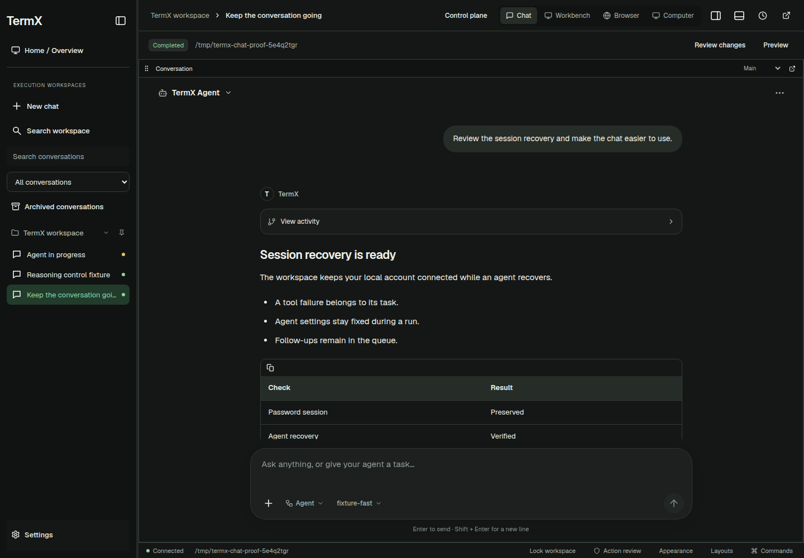
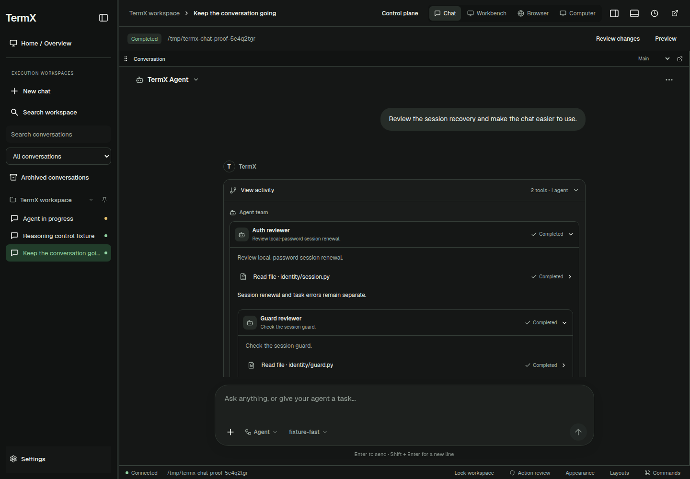

# Session and chat verification

Baseline: `ecd0193a51083c9322fa9aa75c0ecfc6adfa0c68` in `Beyon-Digital/TermXMob`.
See the [change explanation](../../session-agent-chat-fixes.md) for causes, behavior, and design references.

## Results

| Gate | Result |
| --- | --- |
| Combined backend regressions | **181 passed**, 47.62 seconds; 16 dependency deprecation warnings |
| Complete workspace Vitest suite | **385 passed across 81 files** |
| Focused final composer/write coordination regressions | **42 passed**; included in the full suite |
| Focused final message/tool correlation regressions | **14 passed**; included in the full suite |
| TypeScript project build and Vite production build | Passed after the final layout changes; existing large Mermaid chunk warning remains |
| Browser layout and interaction | **8 viewport/theme combinations passed** |
| Bounded axe audits | **13 audits, zero violations** in the audited chat, settings, model, and effort surfaces |
| Browser exceptions and external requests | **Zero** page errors and **zero** external browser requests |
| Local password access-cookie expiry | Refresh **200**; same principal, same conversation, saved draft preserved |
| Task dispatch isolation | Five seeded tasks unchanged; no inference or new task dispatched |
| Rust formatting and whitespace | Passed |
| Actual native crate compile in PR CI | Passed on Linux, Windows, and macOS at implementation commit `6946d134` |

The full frontend suite includes the 10,000-turn virtualization regression, which keeps fewer than 50 message rows mounted. Focused counts above overlap with the complete suite and are not additional tests.

### Backend command

Run from the repository root with the locked development environment. Local execution used temporary configuration and agent directories and disabled startup engine refresh. These directories were deleted after the process exited.

```bash
pytest \
  tests/test_engines.py \
  tests/test_engines_acp.py \
  tests/test_engines_claude.py \
  tests/test_engine_gateway_lifecycle.py \
  tests/test_engine_event_payloads.py \
  tests/test_native_attachments.py \
  tests/test_private_shutdown_order.py \
  tests/test_agent_runtime_config.py \
  tests/test_agent_tools.py::test_provider_runtime_evict_retires_client \
  tests/test_agent_tools.py::test_provider_runtime_evict_defers_close_with_loop \
  tests/test_agent_tools.py::test_provider_runtime_retirement_waits_for_an_active_response_stream \
  tests/test_agent_tools.py::test_provider_runtime_updates_timeout_without_replacing_active_request_settings \
  tests/test_agent.py::test_stream_retry_allowed_before_first_delta \
  tests/test_agent.py::test_stream_retry_suppressed_after_visible_delta \
  tests/test_subagent_cancellation_lifecycle.py \
  tests/test_subagent_approval_integrity.py \
  tests/test_workspace_relay.py \
  tests/test_identity_guard.py \
  tests/test_identity.py \
  tests/test_session_lifecycle.py \
  tests/test_session_policy.py \
  tests/test_workspace_task_activity.py \
  -q -o faulthandler_timeout=30
```

The temporary environment sets `TERMX_CONFIG_DIR`, `TERMX_AGENTS_DIR`, and `TERMX_ENGINE_STARTUP_REFRESH=0`. Tests exercise synthetic provider streams and fake/native protocol fixtures; they do not require live provider credentials.

### Workspace and browser commands

```bash
# desktop/workspace
./node_modules/.bin/vitest run
./node_modules/.bin/tsc -b
./node_modules/.bin/vite build

# Repository root, after building the workspace
uv run --no-sync python tests/workspace_chat_recovery_e2e.py desktop/build/chat-recovery
```

The browser script owns temporary identity, configuration, stores, and project directories. It snapshots the built workspace assets before serving them, authenticates a real password owner, and uses the actual HTTP/GraphQL session and task handlers. Model capabilities and saved/live task content are explicit offline fixtures. It blocks external browser requests and asserts that no inference task was created.

The local gate used Playwright with Chrome 145 via `TERMX_TEST_CHROMIUM`; CI uses Playwright's installed Chromium. The gate is included in `.github/workflows/ci.yml`, and its complete output is uploaded with the `desktop-ui-evidence` artifact.

## Browser coverage

| Viewport | Themes | Checks |
| --- | --- | --- |
| 1440 × 1000 | Dark and light | Conversation, Markdown, saved nested agents/tools, model/mode controls, settings, focus and Escape |
| 390 × 844 | Dark and light | Mobile composer and dialogs, persisted model/mode/profile choices, draft retention |
| 320 × 740 | Dark and light | Narrow viewport bounds, contained content and composer controls |
| 390 × 420 | Dark and light | Short viewport; draft area scrolls independently, controls do not overlap text, composer remains inside the chat region |

Additional interaction checks cover an engine switch's reviewable linked-conversation flow, an advertised native effort slider saved after another metadata revision, and an active task's loader/stop control with execution settings fixed during the run. Expiry recovery removes only the access cookie, reloads through the real authentication path, and verifies the surviving principal, conversation, and saved draft. The recorded expiry refresh sequence is `[200]`.

The [machine-readable report](report.json) contains all viewport geometry, the individual audit results, and the refresh assertions. The screenshots below show synthetic task text and fixture model names, not a user's conversations or live inference results.

## Retained screenshots

| Surface | Screenshot |
| --- | --- |
| Desktop floating composer and formatted answer | [first-desktop-dark.png](first-desktop-dark.png) |
| Mobile composer with retained multiline draft | [chat-390x844-light.png](chat-390x844-light.png) |
| Saved nested agents and tool activity | [saved-nested-activity-dark.png](saved-nested-activity-dark.png) |
| Advertised effort slider in mobile sheet | [native-effort-390-light.png](native-effort-390-light.png) |
| Short mobile viewport | [chat-390x420-light.png](chat-390x420-light.png) |
| Session options and run profiles | [settings-390x844-light.png](settings-390x844-light.png) |





## Native and deployment boundary

The Rust source passes formatting. Local `cargo check --locked --manifest-path desktop/src-tauri/Cargo.toml` stopped at missing Linux GLib/pkg-config prerequisites before compiling the changed workspace module; it is **not** recorded as a successful native compile.

The subsequent [native PR workflow run](https://github.com/Beyon-Digital/TermXMob/actions/runs/39054602282) at implementation commit `6946d134b5b6bf0d5601009605e467ab4bde24e4` passed on Linux, Windows, and macOS. It compiled the actual crate, including `workspace.rs`, and ran the selected updater tests and platform-policy verification. This closes the source-compilation limitation from the local environment. The current head's checks remain visible on [PR #42](https://github.com/Beyon-Digital/TermXMob/pull/42).

Installed-app keyring behavior, a physical mobile software keyboard, and live ACP/vendor services still require their corresponding native/device/service qualification. This change has not been merged, packaged, or deployed to an installed app.
