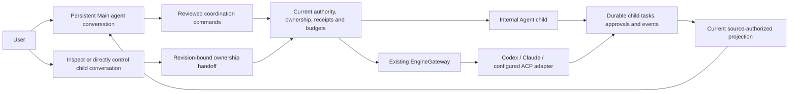

# Persistent main agent

TermX opens one owner-scoped **Main agent** conversation. Establishing or opening
it does not contact a model. Its binding is durable in `workspace.sqlite3`; visiting
a child or an existing direct session does not replace it. New main conversations
use an isolated scratch folder and Agent mode. If a configured provider with a
stored credential exists, its first configured model is selected; otherwise model
setup remains visibly required. No credential is copied or created by this flow. Reopening an existing binding requires its normal view authority; creating one still requires control authority.

The main agent uses the local **Internal Agent** engine. Native and ACP work is
delegated through the existing EngineGateway adapters. Existing conversations
retain their engine, native session identity, history and configuration. They
remain directly accessible. Promoting a native engine to the main coordinator is
not implemented. The native/adoption extension and actual process-crash proof
passed their separate local validation; live vendor/platform limits remain.

## Delegation and project context

The existing `spawn_subagent` tool creates a real child task using AgentManager's
normal plan/action approvals, shared tree budgets and parallel/total worker limits.
When its parent is the main conversation, the host also enrolls a persistent child
conversation. Editing children use an isolated Git worktree or bounded independent
snapshot; Ask children share read-only access to the selected folder. Edits are not
automatically copied into the parent checkout.

`list_agent_projects` returns currently authorized enrolled project IDs and names.
`spawn_project_agent` accepts one explicit project ID, never an arbitrary folder.
The host checks current project execution/control rights before and after isolation
and before plan approval. Only the explicit task/instructions and selected provider
and model enter the child. Project-specific main presets and their instructions or
MCP bindings cannot be copied through this cross-project route; this route requires
the default main agent. Scheduled grants cannot expand into another project.
Child conversation policy identity is distinct from the main conversation.

Scheduled grants cannot execute the persistent main agent: its cross-conversation
history and coordination surface exceed a single reviewed execution target.
Schedule a specific target conversation instead. This is checked before context
or provider dispatch, during recovery validation, and before coordination tools;
no broader unattended grant is created implicitly.

The model tools `managed_session_status`, `message_managed_session` and
`cancel_managed_session` operate only on this owner's enrolled child conversations.
A message steers current work or starts one bounded follow-up in the same child
checkout. A follow-up retains ordinary action checks and cancellation/approval
relay. It does not create an unbounded background inference loop.

## Native engines and existing conversations

`list_agent_engines` reports configured adapters, their installation/sign-in state
and actual advertised capabilities without running inference or authenticating.
`spawn_engine_agent` requires approval of the selected engine and explicit task.
Project work uses an enrolled project ID and an isolated editing checkout; other
work uses a fresh scratch folder. The child uses that engine's existing account.
No credential is copied from the main agent or created for delegation.

The host binds the native task's parent before startup, checks current authority
after adapter preparation yields, and enforces combined admission and host time
limits. Native tool filtering, steering and resume support vary by adapter.
Token usage and monetary cost are not capped or measured by this coordinator;
capability details disclose those limits. Native approval requests remain owned
by their real engine and are surfaced with source-task drilldown. The main model
cannot approve them or silently translate them into Internal Agent grants.

Native monitoring enforces at most 900 seconds of active host time per child, or
its lower configured limit. Pending approval waits pause active charging, with a
separate 24-hour elapsed safety ceiling. Takeover ends coordinator monitoring;
return starts a real lease for the current task. A later user-created native turn
does not inherit the original coordinator task's cancellation intent. Generic ACP
Ask delegation is refused when read-only enforcement cannot be verified.

Existing chats can be reviewed and included in main-agent updates from their
settings without a model call. Model tools `review_managed_session` and
`adopt_managed_session` use the same exact revision/digest review, with an explicit
tool approval. Enrollment preserves the native session, folder and conversation
history. It initially leaves control with the user; enrollment and return of
control are separate actions. An idle enrolled chat has no fabricated task.

Scheduled/delegated runs must target a specific conversation. Executing the
persistent main conversation under a scheduled grant is refused before context
or provider dispatch: its cross-project coordination surface exceeds one target
grant. Existing scheduled conversations do not gain access to other children.

## Task graph

For work with dependencies the main agent records a graph of **nodes** instead of
spawning ad-hoc children. A node is a durable `orchestrator_node` record in
`workspace.sqlite3` with a title, prompt, role, `ask` or `agent` mode, the IDs it
`depends_on`, its task IDs, status, attempt count, last event time and a result
summary. An internal node (the default executor) runs as its own top-level task through `AgentManager.create_task`,
so delegation depth stays 1, the sub-agent parallel and total limits do not apply, and
every node has its own budget, approvals and isolation: a Git worktree when the main
folder is a repository, the managed scratch folder when it is scratch, and
read-only `ask` otherwise. At most four nodes run at once. Nodes use the `worker`
model route, or the provider and model set by `reassign_node`.

| Tool | Approval | What it does |
| --- | --- | --- |
| `plan_nodes` | none | Records up to 20 nodes per call (100 per main agent). Rejects unknown dependencies, self-dependencies, duplicate keys, cycles and any executor outside the allowlists below. A replayed call ID returns the same nodes. |
| `start_ready` | always | Starts pending nodes whose dependencies all completed. Each brief carries the dependency summaries, labelled as untrusted evidence. A failed or cancelled dependency keeps its dependents pending. Engine and CLI nodes make it an always-ask `delegation` decision (see below). |
| `node_status` | none | Nodes plus a rollup. `wait_seconds` (max 120) waits for a running node to change state, which is how a turn waits without a background loop. |
| `retry_node` | always | Reruns a failed, stalled or cancelled node, stopping a stalled one first. A node gets 2 attempts per model. On a CLI node whose session was lost it resumes that session instead (never a second launch). |
| `reassign_node` | always | Moves a stopped or pending **internal** node to another configured provider/model (resolved like any worker route) with a fresh attempt count. The model must differ from the current one. Engine and CLI nodes do not use a model provider and refuse it. |
| `cancel_node` | none | Cancels the node and, transitively, every dependent that has not completed. A CLI node's session is stopped and an engine node's native session is cancelled. Completed work is kept. |
| `review_node_changes` | none | Read-only: a bounded, redacted summary and diff of the node's isolated checkout (see Executors). |

### Executors

Each node carries an `executor` saying who does its work. It defaults to `{"kind":"internal"}`,
so graphs and plans stored before executors existed behave exactly as before (a missing
field reads as internal; nothing is rewritten).

| `kind` | Fields | Runs as | Prefer it for |
| --- | --- | --- | --- |
| `internal` | none (use the node `mode`) | The Internal Agent, a top-level task through `AgentManager.create_task` (what nodes always did) | Small, self-contained tasks, and anything a bot should do |
| `engine` | `engine` (an id from `list_agent_engines`), optional `mode` (`agent` or `ask`; `ask` only for `codex`/`claude`) | A protocol-engine child through `EngineCoordination.spawn`, the same path and receipts as `spawn_engine_agent`; edits go to an isolated worktree or snapshot | Structured, background coding work that should run to completion |
| `cli` | `cli` (`claude`, `codex`, `gemini`, `aider`), optional `mode` (`default` or `read_only`; defaults to `read_only` for an `ask` node), optional `isolation` (`worktree`, the default, or `none`) | A real interactive CLI session ([docs/cli-sessions.md](cli-sessions.md)): a PTY, hooks and a status machine, visible and steerable from the terminal and from phones | The user wants the actual TUI, or a workflow specific to that CLI |

Validation is a strict allowlist: unknown fields, an unknown kind, an engine the
gateway does not list, a CLI outside the catalogue, `bypass`/`yolo` or any raw argv are
refused at `plan_nodes`, and a node that names a bot must use `internal`.

**Approval.** Starting a CLI is always-ask. `start_ready` and `retry_node` for such nodes
run the same checks as `cli_session_start` (CLI installed, `terminal-control` and, for a
worktree, `git-read`/`git-write` on the project) and return the same `delegation` decision
with the same text and the `cli.session.start` capability, so Auto and remembered rules never
answer for the owner. Engine nodes are `delegation` too. The user starting nodes from the
board is the owner and has no approval step, as for every other board action. Engine
children are parented to a main-agent turn, so they start only from `start_ready`/
`retry_node` run by the main agent; started from the board they stay pending.

**Settling.** A node settles from its executor's events, with a repair on every board read and
at host start. Engine nodes settle from their task like internal ones. CLI nodes follow the
session status:

| Session | Node |
| --- | --- |
| `starting`, `working` | `running` (a blocked node returns to `running` when the session works again) |
| `needs_approval` | `blocked` (`blocked_reason: needs_approval`) at once |
| `waiting_input` | `blocked` (`waiting_input`) once the session has been at the prompt after its first 30 seconds; the first seconds are startup, not waiting |
| `done` (clean exit, or stopped) | `completed` |
| `failed` (non-zero exit) | `failed` |
| `lost` and resumable | `blocked` (`lost`): `retry_node` resumes the CLI's own saved conversation |
| `lost` and not resumable | `failed` |

A blocked node tells the main agent and the user once per reason
(`orchestrator.node_blocked`); it is waiting on a person, not stalled, and the main agent must
not start a duplicate. A node counts against the four-running limit while its terminal is alive
(running or blocked) and frees its slot when the session is lost. A CLI session is interactive,
so it does not end by itself: the main agent reviews the work, then stops the session
(`cli_session_stop`) and the node completes. A CLI node never goes `stalled` from quiet time.

**Restart safety.** The session id is recorded on the node before the CLI launches. After a host
restart a node whose session the PTY holder kept alive is matched by that id and is not launched
again; a session that ended while the host was down settles the node; a lost session becomes a
resumable blocked node. A launch that crashed before the session existed fails the node with a
clear error and waits for an explicit retry. An engine launch replayed after a crash reuses its
receipt, so it cannot create a second child. A session the owner resumed from another client is
followed by the node.

**Reviewing a node.** `review_node_changes {node_id}` returns the node's changes as untrusted data:
file list (at most 40), up to 8 redacted diffs (6,000 characters each, 30,000 in total) and flags
saying what was left out. The checkout comes from TermX's own records (the CLI session's worktree,
the engine child's isolation, the internal task's worktree or scratch folder), never from the model,
and the caller needs `agent-view` plus `git-read` on the project. It uses the same read-only review
as the changes view (`workspace/change_review.py`), shows uncommitted changes against `HEAD` (a CLI
that commits its own work, such as Aider, shows its branch and head but no diff), and has no apply
path: applying or merging stays behind the existing delivery approvals. Nodes that ran read-only
have nothing to review.

**Monitoring.** Every event of a node's current task refreshes its `last_event_at`,
not only the notable ones (the stored value is written at most every 5 seconds per
node). A running node with no event for `stall_seconds` becomes `stalled`: 300 by
default, set with `state.node_stall_seconds` or `TaskGraph(stall_seconds=...)`. One
`orchestrator.node_stalled` event is added to the activity feed and steers an active
main turn. Nothing is stopped automatically. A task that waits for an approval or
a decision is not stalled, and any new event returns a stalled node to `running`.
Failures and completions are reported the same way (`orchestrator.node_failed`,
`orchestrator.node_completed`), and a CLI node that needs a person adds `orchestrator.node_blocked`. A read repairs a node whose finishing event was
missed, for example across a host restart.

**Rollup.** The orchestrator snapshot includes `nodes` and `rollup`: counts per status,
percent complete (completed over total), and summed tokens and cost across all
attempts. Cost is `null` until some node has a priced turn.

A node view also carries `executor`, `blocked_reason`, `session_id` (its CLI session or engine
conversation) and `resumable`; `blocked` is a rollup status of its own.

**User control.** The same operations are available over GraphQL. `orchestrator_board`
(`agent-view`) returns `{nodes, rollup}`; `retry_node`, `reassign_node` and
`cancel_node` (`agent-control`, plus `agent-run` for the two that start a task) call
the methods behind the tools and return the updated board. They act as the signed-in
user, only on that user's own main agent graph, and answer 403 without the scope, 404
for an unknown node, 409 for a state conflict and 400 for an invalid model. Users have no
approval step for these actions; the tools do, because the model is not the user.
Stall, failure and completion events appear in the main agent activity feed.

## Updates and direct control

Child status, approvals, failures, recovery decisions and results enter a durable,
bounded activity feed. An active main turn receives child decision/result updates
as steering context. Every subsequent main turn receives a fresh, permission-filtered
child snapshot. Tool output and child reports remain untrusted evidence, never
permission to perform another action.

If the main turn has already finished, a late child result or decision appears
inline as a **Direct report**. This is a `coordination` report reference, with no
model request. Its completed ledger envelope describes delivery of the report;
`source_status` describes the child's actual outcome. Source output remains in the
child task and is resolved under current source permissions at read time. A late
approval cannot resurrect a completed main task into a phantom active worker.

Taking control is explicit and revision-bound. Sending a direct child turn or
steering its task also transfers control to the user. Main-agent message/cancel
tools, including legacy `cancel_subagent`, refuse a directly controlled child until
the user returns it. Automatic child-plan approval also stops after takeover.
The user's explicit Stop task/tree action retains its safety cascade semantics.

## Recovery and request identity

Spawn call IDs bind to an argument/target digest and a durable child ID. Replaying
the same call returns the original child, including a cancelled child; changed
content is refused. Managed steering, cancellation and follow-up calls have durable
command receipts. A dispatch with an uncertain outcome requires inspection and is
never automatically retried.

Native bindings retain actual wire-turn ownership and explicit host dispatch
generations. Known old events stay with their original task. Unknown turn content
is privately bounded until an actual start event or RPC response proves ownership;
it cannot populate a newer task by guessing from a cached session ID. Captured
driver generations also protect completion/error/cancel cleanup. ACP session-only
unsolicited stream chunks still have no reliable cross-turn identity.

Child conversation identities derive from the original task ID. Reconciliation
repairs partially committed conversation metadata, canonical turns and resource
claims without launching work. Historical reconciliation runs on the first read
after service startup or a child-enrollment repair, rather than on every UI poll.
Current status takes priority over history when choosing the bounded child list;
the response discloses truncation. Event/report identities deduplicate reconnect
and restart replay. Parent cancellation is checked before and after preparation,
at task creation, and at child execution/recovery boundaries.

On host restart, recovery scans the complete active ledger rather than only
recent history. Recorded cancellation never enters tool replay. Pending private
Internal tool requests cannot be reconstructed from their public/redacted approval
records: they are denied under their original IDs and fail with fresh-instruction
guidance. Parent approval wrappers are reconstructed only from verified child
bindings. A safe checkpoint and an ambiguous side effect keep their distinct
recovery paths; concurrent confirmation cannot launch a second worker.

Managed reviewed tools link their execution checkpoint to the real broker receipt.
The permit is consumed before the running boundary and is never persisted in that
checkpoint. After a crash, a prepared/running reviewed effect requires inspection
and a fresh instruction; even recovery confirmation cannot replay its permit. A
saved completed result can be reused once without executing again, while further
inference still respects the actual restart budget gate.

Native processes lose their live host binding at restart. Tasks interrupted before
or after native-session enrollment are marked explicitly interrupted without
automatic replay. Lost native approval requests are denied. An explicit new
instruction can use the adapter's supported resume path after inspection.

## HTTP contracts

All routes use the existing managed-session authentication, locked-session checks
and mutation protection.

| Route | Behavior |
| --- | --- |
| `GET /api/workspace/orchestrator` | Primary session, up to 100 children with attention/active work first, activity, cursor and truncation metadata |
| `POST /api/workspace/orchestrator/ensure` | Establish or return the existing main binding; optional `session_id` requires an eligible internal conversation |
| `GET /api/workspace/orchestrator/activity?after=N` | Current-authority activity after a durable sequence cursor; bounded to 100 returned events |
| `POST /api/workspace/orchestrator/children/{id}/control` | Transfer control with `{owner:"user"\|"orchestrator", revision:N}`; stale state returns 409 |
| `GET /api/workspace/orchestrator/adoption-preview/{id}` | Review the exact current authorized engine, folder, revision and enrollment effect |
| `POST /api/workspace/orchestrator/adopt` | Enroll the reviewed target with its digest, revision and stable request ID; retain user control |

## Local verification

`tests/test_workspace_orchestrator.py` passed all 14 tests against the real
AgentManager, SQLite ledgers, tool registry, approval gates and cancellation
runtime. Inference alone uses deterministic adapters; no provider request or
credential transmission occurred. Coverage includes concurrent main establishment,
provider-tool child creation and completion, replay deduplication, direct ownership,
late inline reports, execution-status preservation, current-permission report redaction, partial enrollment repair,
legacy cancellation takeover boundaries, cancellation during hook preparation,
terminal-parent approval behavior, and explicit project authorization.

The queue/approval/cancellation/team regression group passed 34 cases; the final
team event-contract case passed after updating its assertion for the new dispatch
digest. These checks do not establish live provider behavior, real native/ACP
delegation, installed Tauri behavior or physical-device behavior. No Rust command,
GitHub CI workflow, deployment, push or merge was run for this implementation.

The final production browser proof passed 13 journey checks and 9 accessibility audits, including real password refresh, two approval gates before child spawn, explicit handoffs, direct child turns, late no-inference reports, exact-once Stop and same-port host restart. See [final verification](verification/chat-first-final-2026-10-25.md). Inference is deterministic fixture data; native/ACP delegation and guest-browser navigation remain outside this proof.

The native/adoption and abrupt in-flight restart extension has separate evidence
and must not inherit the checkpoint's passing status. See
[extension verification](verification/orchestration-extension-2026-10-25.md) and
[process-crash proof](verification/process-crash-2026-10-25.md).
